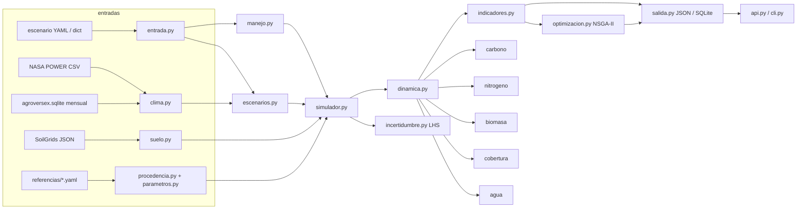

# Gemelo digital AGROVERSE · núcleo

Núcleo de simulación y optimización del gemelo digital de AGROVERSE (rama `gemelo`). Representa un lote agrícola como un sistema dinámico que avanza día a día bajo un clima, un suelo y una estrategia de manejo, y compara estrategias y rotaciones con su incertidumbre. Las ramas `datos`, `web` e integración consumen este núcleo por el contrato [`contratos/gemelo_api.md`](../../contratos/gemelo_api.md).

$$\frac{dx}{dt} = f(x, u, e, \theta), \qquad x = [W, N, C, B, V]$$

| Símbolo | Significado | Unidad |
|-|-|-|
| $W$ | agua del perfil de suelo | mm |
| $N$ | nitrógeno mineral del suelo | kg N/ha |
| $C$ | carbono orgánico del suelo, 0-30 cm | t C/ha |
| $B$ | biomasa aérea del cultivo | kg MS/ha |
| $V$ | cobertura vegetal verde | fracción 0-1 |
| $u(t)$ | decisiones: cultivo, siembra, riego, fertilización, residuos, labranza | |
| $e(t)$ | clima diario: lluvia, temperatura, radiación, humedad, viento | |
| $\theta$ | parámetros de suelo, cultivo y procesos, cada uno con procedencia | |

Todo resultado es **simulado**: estima tendencias y compromisos entre estrategias, no reemplaza mediciones.

## Contenido

1. [Inicio rápido](#1-inicio-rápido)
2. [Arquitectura](#2-arquitectura)
3. [Convenciones](#3-convenciones)
4. [Integración temporal del estado](#4-integración-temporal-del-estado)
5. [Módulos y matemáticas](#5-módulos-y-matemáticas)
6. [Ensamble e incertidumbre](#6-ensamble-e-incertidumbre)
7. [Optimización multiobjetivo NSGA-II](#7-optimización-multiobjetivo-nsga-ii)
8. [Entrada, salida y consola](#8-entrada-salida-y-consola)
9. [Validación](#9-validación)
10. [Cómo se desarrolló: decisiones y correcciones](#10-cómo-se-desarrolló-decisiones-y-correcciones)
11. [Limitaciones conocidas](#11-limitaciones-conocidas)
12. [Referencias](#12-referencias)

## 1. Inicio rápido

Python 3.12. Desde la raíz del repositorio:

```powershell
uv venv --python 3.12 .venv
uv pip install --python .venv/Scripts/python.exe -r requirements-gemelo.txt
$env:PYTHONPATH = "src"                       # en bash: export PYTHONPATH=src

.venv/Scripts/python.exe -m gemelo cultivos   # catálogo y qué falta para simular cada cultivo
.venv/Scripts/python.exe -m gemelo simular   ejemplos/escenario_ames.yaml    -o salidas/ames_simulacion.json
.venv/Scripts/python.exe -m gemelo optimizar ejemplos/escenario_ipiales.yaml -o salidas/ipiales_optimizacion.json --sqlite salidas/gemelo.sqlite
.venv/Scripts/python.exe -m pytest pruebas/gemelo     # 66 pruebas, ~1 min
```

Como biblioteca:

```python
from gemelo import simular, optimizar_rotacion
doc = simular("ejemplos/escenario_ames.yaml")     # dict con el contrato; también acepta un dict
doc["estrategias"][0]["indicadores"]["lixiviacion_n_kg_ha_anio"]   # {'p10': ..., 'p50': ..., 'p90': ..., 'unidad': ...}
```

Datos de referencia incluidos: NASA POWER diario 2005-2024 y SoilGrids 2.0 para Ames (Iowa, EE. UU.) e Ipiales (Nariño, Colombia), en `datos/referencia/`.

## 2. Arquitectura



| Módulo | Responsabilidad |
|-|-|
| `procedencia.py` | `Parametro` con valor, unidad, etiqueta, referencia, ficha EV, rango, distribución y naturaleza; tablas YAML |
| `parametros.py` | Catálogo de cultivos: lee FAO-56 textual y parámetros biológicos; marca PENDIENTE |
| `clima.py` | NASA POWER, calendario nominal, ET0 FAO-56 (Penman-Monteith y Hargreaves), desagregación mensual a diaria |
| `suelo.py` | SoilGrids, pedotransferencia de Saxton y Rawls, grupo hidrológico, número de curva, drenaje |
| `fenologia.py` | Etapas, curva de Kc, profundidad radicular, cobertura potencial |
| `agua.py`, `cobertura.py`, `biomasa.py`, `nitrogeno.py`, `carbono.py` | Procesos, cada uno vectorizado sobre miembros del ensamble |
| `dinamica.py` | Integración diaria acoplada y equilibrio inicial del carbono |
| `manejo.py` | Compila una estrategia a series diarias |
| `escenarios.py` | Escenarios climáticos con años reales |
| `incertidumbre.py` | Hipercubo latino, percentiles, CVaR |
| `indicadores.py` | Definición y cálculo de indicadores |
| `simulador.py` | Orquesta el ensamble estrategias x clima x parámetros |
| `optimizacion.py` | NSGA-II de rotaciones con restricciones y explicación de compromisos |
| `entrada.py`, `salida.py`, `api.py`, `cli.py` | Contrato de entrada y salida, biblioteca y consola |

## 3. Convenciones

**Procedencia.** Ningún número entra al modelo sin `Parametro`. Etiquetas del equipo:

| Etiqueta | Uso | En el ensamble |
|-|-|-|
| FUENTE | Transcrito de una referencia; `ficha` = id EV-* | Fijo, o rango si la fuente lo da (p. ej. Kc "0,60-0,35", cuantiles de SoilGrids) |
| INFERENCIA | Derivado de una fuente pero usado fuera de su contexto | Rango del error de la relación |
| SUPUESTO | Valor de diseño sin referencia directa | Siempre con rango |
| PENDIENTE | Sin valor defendible | El cálculo se detiene con `ParametroPendiente` y dice qué falta |

Naturaleza de cada dato: `observado` (medido o dado por el usuario), `derivado` (calculado de observados, p. ej. clima desagregado), `estimado` (reanálisis o mapas globales: POWER, SoilGrids) y `simulado` (salida del gemelo). La calibración con un dato local convierte el parámetro en FUENTE `observado` y quita su rango.

**Calendario nominal.** 365 días por año, sin 29 de febrero. Las fechas se escriben `A2-05-15` (año 2 del horizonte, 15 de mayo), así una estrategia vale para cualquier año de inicio del clima.

**Código.** Nombres en español, unidades en el nombre de los indicadores (`_mm_anio`, `_kg_ha`), funciones de proceso puras y vectorizadas con numpy (operan sobre arreglos `(M,)` de miembros).

## 4. Integración temporal del estado

**Subestados.** El estado de cinco variables se resuelve con subestados internos:

| Variable | Subestados |
|-|-|
| $W$ | $W_1$ (zona radicular, espesor $z_1(t)$) y $W_2$ (resto del perfil, $z_p - z_1$) |
| $C$ | Reservorio joven $Y$ y reservorio viejo $O$, con nitrógeno orgánico $Y_N$ y $O \cdot 1000/(C{:}N)$ |
| $B$ | N de la planta, biomasa potencial sin estrés $B_{pot}$ y biomasa limitada solo por radiación $B_{max}$ |
| Superficie | Masa de residuo superficial $M_r$, que es parte de $Y$ |

**Esquema numérico.** Euler explícito con paso de un día, división de operadores y flujos limitados: ningún flujo extrae más de lo que hay en su reservorio. Esto garantiza $W, N, Y, O, B \ge 0$ y el cierre exacto de masa de agua, N y C (error de redondeo, ~1e-13 mm). Con `n_sub > 1` los procesos continuos (infiltración, drenaje, ET, crecimiento, descomposición, lixiviación) se resuelven en subpasos; los eventos (siembra, riego, escorrentía, fertilización, cosecha) son diarios.

**Orden dentro de cada día $t$:**

1. Profundidad radicular $z_1(t)$ y redistribución del agua entre capas; reinicio de la planta en la siembra; labranza.
2. ET potencial ($K_c \cdot ET_0$), riego automático, escorrentía por número de curva y fertilización.
3. Por subpaso: infiltración, drenaje de cada capa, coeficiente de estrés y ET real, cobertura, crecimiento limitado por agua y N, ICBM con mineralización, lixiviación.
4. Cosecha al final del último día de la temporada: exportación y paso del residuo a $Y$ y a la superficie.

## 5. Módulos y matemáticas

### 5.1 Parámetros y catálogo (`procedencia.py`, `parametros.py`, `referencias/`)

- `cultivos.yaml` guarda la fila de FAO-56 (Tablas 11, 12 y 22) **textual**, tal como la transcribió la rama de datos (ficha EV-ROT-010; agua EV-ROT-011), más parámetros biológicos con `[valor, mínimo, máximo]`.
- `leer_kc` interpreta los textos de FAO: "0,60–0,35" da el valor central 0,475 con rango [0,35, 0,60]; "0,4 helado; 0,7 no helado" toma la primera alternativa y deja las dos como rango.
- `leer_etapas` lee "15/15/40/15 = 85 trópico; 20/30-35/60/25 = 140 centro EE. UU." y elige una variante por texto. Un intervalo "30-35" da su mínimo.
- Cultivos perennes (caña, café, alfalfa) quedan `apto_rotacion: false`. El trébol berseem queda con etapas PENDIENTE (FAO no las da), pero se puede simular si el usuario da sus etapas.
- `agua_suelo.yaml` y `carbono_nitrogeno.yaml` guardan los parámetros de proceso. `sucesion.yaml` es la copia de la tabla `regla_sucesion` de la rama datos.

### 5.2 Clima (`clima.py`)

**NASA POWER.** Variables: lluvia corregida (PRECTOTCORR), T2M, T2M_MAX, T2M_MIN, RH2M, radiación de onda corta (ALLSKY_SFC_SW_DWN) y viento a 2 m (WS2M). Se quita el 29 de febrero, se exigen años completos y se interpolan huecos de hasta 5 días (contados en la salida). Es reanálisis MERRA-2 más CERES, por eso su naturaleza es `estimado`.

**Radiación extraterrestre** (FAO-56 ec. 21-25):

$$R_a = \frac{24 \cdot 60}{\pi} G_{sc}\, d_r \left[\omega_s \sin\varphi \sin\delta + \cos\varphi \cos\delta \sin\omega_s\right]$$

con $d_r = 1 + 0{,}033\cos(2\pi J/365)$, $\delta = 0{,}409\sin(2\pi J/365 - 1{,}39)$ y $\omega_s = \arccos(-\tan\varphi\tan\delta)$.

**ET0 de Penman-Monteith** (FAO-56 ec. 6), en mm/día:

$$ET_0 = \frac{0{,}408\,\Delta (R_n - G) + \gamma \frac{900}{T + 273} u_2 (e_s - e_a)}{\Delta + \gamma (1 + 0{,}34 u_2)}$$

- $G = 0$ a paso diario.
- $R_n = (1-\alpha) R_s - R_{nl}$, con $\alpha = 0{,}23$.
- $R_{nl}$ por la ec. 39, con $R_s/R_{so} \le 1$ y $R_{so} = (0{,}75 + 2\cdot10^{-5} z) R_a$.
- $e_a = HR/100 \cdot e_s$ (ec. 19).
- $\gamma$ a partir de la presión atmosférica por elevación (ec. 7-8).

Sin radiación o humedad se usa **Hargreaves-Samani** (ec. 52): $ET_0 = 0{,}0023\,(T + 17{,}8)\sqrt{T_{max} - T_{min}}\; 0{,}408\,R_a$. El método usado sale en `metadatos.metodo_eto`.

**Desagregación mensual** (para la tabla `mensual` de la rama datos). La lluvia del mes $P_m$ se reparte en $n = \lceil P_m / 10 \text{ mm}\rceil$ días húmedos al azar (SUPUESTO 10 mm por día húmedo), con montos exponenciales normalizados a $P_m$, así que el total mensual se conserva exactamente. Las demás variables se interpolan linealmente entre los centros de cada mes. La naturaleza resultante es `derivado`.

### 5.3 Suelo (`suelo.py`)

**De SoilGrids a propiedades del lote.** Arena, arcilla, densidad aparente y pH se promedian por espesor en 0-100 cm. La media es el valor central y el rango sale de los cuantiles Q0,05-Q0,95. La materia orgánica es $MO = COS/0{,}58$ (INFERENCIA). Los otros dos valores se calculan así:

$$COS_{0\text{-}30} = \sum_{capas} SOC\,[g/kg] \cdot \rho_b\,[kg/dm^3] \cdot e\,[cm] \cdot 0{,}1 \quad [t\,C/ha], \qquad C{:}N = SOC / N_{total}$$

**Pedotransferencia de Saxton y Rawls (2006), Tabla 1.** Con $S$ y $C$ en kg/kg y $OM$ en %:

$$\theta_{1500t} = -0{,}024S + 0{,}487C + 0{,}006OM + 0{,}005S\,OM - 0{,}013C\,OM + 0{,}068SC + 0{,}031$$
$$\theta_{1500} = \theta_{1500t} + (0{,}14\,\theta_{1500t} - 0{,}02)$$
$$\theta_{33t} = -0{,}251S + 0{,}195C + 0{,}011OM + 0{,}006S\,OM - 0{,}027C\,OM + 0{,}452SC + 0{,}299$$
$$\theta_{33} = \theta_{33t} + (1{,}283\,\theta_{33t}^2 - 0{,}374\,\theta_{33t} - 0{,}015)$$
$$\theta_{S-33} = \theta_{S-33t} + (0{,}636\,\theta_{S-33t} - 0{,}107), \quad \theta_{sat} = \theta_{33} + \theta_{S-33} - 0{,}097S + 0{,}043$$
$$B = \frac{\ln 1500 - \ln 33}{\ln\theta_{33} - \ln\theta_{1500}}, \quad \lambda = 1/B, \quad K_{sat} = 1930\,(\theta_{sat} - \theta_{33})^{3-\lambda}\;[mm/h]$$

- **Dominio de validez:** $OM \le 8$ % y arcilla $\le 60$ %. Fuera de él las entradas se recortan y se emite un aviso. Es el caso de Ipiales (MO 8,15 %, posible Andisol).
- **Rangos del ensamble:** ±0,02 en $\theta_{pmp}$ y ±0,05 en $\theta_{cc}$ y $\theta_{sat}$ (error típico de las ecuaciones). $K_{sat}$ va de ÷3 a ×3.

**Grupo hidrológico y número de curva.** El grupo se toma de NRCS NEH 630 cap. 7 por $K_{sat}$ (A > 10, B > 4, C > 0,4 µm/s). Los CN de TR-55 se usan para cultivo en hilera, barbecho desnudo y barbecho con residuo. El CN del día interpola según la cobertura viva $V$ y la de residuo $f_r$ (INFERENCIA; TR-55 da clases discretas):

$$CN = V\,CN_{cult} + (1-V)\left[(1-f_r)\,CN_{desn} + f_r\,CN_{res}\right]$$

**Drenaje** (AquaCrop): $\tau = 0{,}0866\,(K_{sat}\,[mm/día])^{0{,}35}$, acotado a [0, 1].

### 5.4 Fenología (`fenologia.py`)

**Etapas FAO-56** $(L_{ini}, L_{des}, L_{med}, L_{fin})$ en días. La curva de Kc (ec. 66) se escribe como pesos lineales, así un mismo calendario sirve para todos los miembros del ensamble aunque sus Kc difieran:

$$K_c(t) = w_{ini}(t)\,K_{c,ini} + w_{mid}(t)\,K_{c,mid} + w_{end}(t)\,K_{c,end}, \qquad w_{ini} + w_{mid} + w_{end} = 1$$

$K_c$ es constante en la etapa inicial, crece linealmente en el desarrollo, se mantiene en la etapa media y baja linealmente en la final.

**Raíces.** $z_r(t) = z_{r,ini} + (z_{r,max} - z_{r,ini}) \min(1, t/(L_{ini}+L_{des}))$ (INFERENCIA lineal).

**Cobertura potencial** (FAO-56 ec. 76, aplicada a Kc único, INFERENCIA):

$$V_{pot} = \left(\frac{K_c - K_{c,min}}{K_{c,max} - K_{c,min}}\right)^{1 + 0{,}5h}, \qquad K_{c,max} = \max(1{,}20,\, K_{c,mid} + 0{,}05)$$

### 5.5 Agua (`agua.py`)

**Balance:**

$$\frac{dW}{dt} = P + I - ET_a - R - D, \qquad W = W_1 + W_2$$

- **Redistribución al cambiar $z_1$.** Si las raíces profundizan, pasa a la capa 1 la fracción $(z_1' - z_1)/(z_p - z_1)$ de $W_2$. Si la zona se reduce (cosecha), baja a la capa 2 la fracción $(z_1 - z_1')/z_1$ de $W_1$. El agua total no cambia.
- **Escorrentía** (SCS): $S = 25400/CN - 254$, $I_a = 0{,}2S$, $R = (P - I_a)^2/(P - I_a + S)$ si $P > I_a$.
- **Infiltración.** $P - R + I_{neto}$ entra a la capa 1; lo que excede la saturación pasa a la capa 2, y lo que excede la de la capa 2 escurre.
- **Drenaje.** $D_1 = \tau\max(W_1 - W_{1,cc}, 0)$ pasa de la capa 1 a la 2. $D = \tau\max(W_2 - W_{2,cc}, 0)$, más cualquier rebalse de saturación, sale del perfil. Para $n$ subpasos $\tau_n = 1 - (1-\tau)^{1/n}$, que drena lo mismo en un día sin otros flujos.
- **Agotamiento admisible** (FAO-56 Tabla 22): $p = p_{tabla} + 0{,}04(5 - ET_c)$, acotado a [0,1, 0,8]. $RAW = p\,(W_{1,cc} - W_{1,min})$.
- **Coeficiente de estrés** (ec. 84). Con agotamiento $D_r = W_{1,cc} - W_1$ y agua disponible $A = W_{1,cc} - W_{1,min}$:

$$K = 1 \text{ si } D_r \le RAW, \qquad K = \frac{A - D_r}{A - RAW} \text{ si no}$$

  En barbecho el mismo coeficiente actúa como reductor de evaporación (ec. 74), con umbral $REW = 9$ mm y una capa que puede secarse hasta $0{,}5\,\theta_{pmp}$ (ec. 73).
- **ET real.** $ET_a = \min(K\,ET_c,\; W_1 - W_{1,min})$, que nunca deja la capa bajo su mínimo.
- **Riego automático** (FAO-56 cap. 8). Si $D_r > \text{umbral} \cdot RAW$, se repone a capacidad de campo: $I_{neto} = \min(D_r,\; (tope - usado)\,\eta)$ y $I_{bruto} = I_{neto}/\eta$, con eficiencia $\eta = 0{,}75$ (SUPUESTO).

### 5.6 Cobertura y residuos (`cobertura.py`)

- **Expansión limitada por estrés.** $V_{t+1} = \min\left(V_t + \max(\Delta V_{pot}, 0)\, g,\; V_{pot}\right)$, con $g = \min(K, f_N)$. El dosel que no se formó por estrés no se recupera (INFERENCIA de AquaCrop).
- **Kc con dosel menor que el potencial:** $K_c' = K_{c,min} + (K_c - K_{c,min})\,V/V_{pot}$.
- **Suelo desnudo:** $K_c = K_{c,max,suelo}(1 - 0{,}5 f_r)$ (mulch, FAO-56 cap. 11).
- **Cobertura del residuo** (forma de Gregory, 1982): $f_r = 1 - e^{-A_m M_r}$, con $A_m = 0{,}0004$ ha/kg.
- **Fracción desnuda:** $(1 - V)(1 - f_r)$.
- **Residuo en superficie.** La cosecha deja el residuo en superficie, salvo con `residuos: incorporar`. Se descompone a la misma tasa relativa que $Y$, y la labranza lo entierra.

### 5.7 Biomasa (`biomasa.py`)

**Eficiencia de uso de la radiación** (Monteith, 1977), en kg MS/ha/día:

$$\frac{dB}{dt} = 10 \cdot RUE \cdot V \cdot R_s \cdot f_T(T) \cdot \min\!\left(K,\; f_N\right)$$

**Función beta de temperatura** (Yan y Hunt, 1999):

$$f_T = \left(\frac{T_{max} - T}{T_{max} - T_{opt}}\right)\left(\frac{T - T_b}{T_{opt} - T_b}\right)^{\frac{T_{opt} - T_b}{T_{max} - T_{opt}}}$$

$f_T$ vale 0 fuera de $(T_b, T_{max})$ y 1 en $T_{opt}$.

**Biomasas de referencia.** Se integran dos más en paralelo:
- $B_{pot}$: sin estrés de agua ni de N, con la cobertura potencial.
- $B_{max}$: solo radiación, con $f_T = 1$.

De ahí salen tres indicadores:
- rendimiento relativo $Y/Y_{pot}$ (cuánto limitaron agua y N);
- aptitud térmica $Y_{pot}/Y_{max}$ (cuánto limita el clima térmico del lugar);
- índice productivo $Y/Y_{max}$.

**Cosecha.** $Y = IC \cdot B$ y $N_{exp} = IC_N \cdot N_{planta}$. El resto pasa a residuo. Un cultivo de cobertura (`cosechar: false`) no exporta nada.

Se eligió RUE en lugar de la logística $dB/dt = rB(1 - B/K)g$ de la especificación conceptual: la logística necesita una capacidad $K$ sin fuente por cultivo y lugar, mientras que RUE tiene valores de literatura y responde a la radiación del lugar. `logistica()` queda como variante.

### 5.8 Nitrógeno (`nitrogeno.py`)

**Balance:**

$$\frac{dN}{dt} = F_N + M_N - U_N - L_N$$

- **Fertilizante.** Entra $F_N = (1 - f_{vol})\,F$ con $f_{vol} = 0{,}10$ (IPCC 2019, FracGASF). La volatilización se reporta aparte.
- **Demanda y ley del mínimo.** La demanda del día es $n_B\,\Delta B$, con $n_B$ la concentración de N de la biomasa. Una leguminosa fija la fracción $Ndfa$. Si el suelo no cubre el resto, la fijación sube hasta $Ndfa_{max} = 0{,}9$ de la demanda (SUPUESTO, rango 0,8-0,95), porque la fijación aumenta cuando el suelo es pobre. Con $N_{disp} = N \cdot z_1/z_p$ (N accesible a las raíces, SUPUESTO de distribución uniforme):

$$U = \min\left((1 - Ndfa)\,n_B\Delta B,\; N_{disp}\right), \quad Fij = \min\left(n_B\Delta B - U,\; \max(Ndfa_{max}, Ndfa)\, n_B\Delta B\right), \quad f_N = \frac{U + Fij}{n_B\Delta B}$$

  El crecimiento efectivo es $f_N \Delta B$.
- **Lixiviación.** Supone concentración uniforme en el agua del perfil (SUPUESTO): $L = N \cdot D/(W + D)$.
- **Fijación.** El N fijado va a la planta, no al suelo. Llega al suelo cuando el residuo se mineraliza.

### 5.9 Carbono y mineralización (`carbono.py`)

**ICBM** (Andrén y Kätterer, 1997) con N acoplado:

$$\frac{dY}{dt} = i - k_1 r Y, \qquad \frac{dO}{dt} = h\,k_1 r Y - k_2 r O$$

- Parámetros: $k_1 = 0{,}8$/año, $k_2 = 0{,}006$/año y coeficiente de humificación $h = 0{,}125$ para residuos de cultivo.
- Entrada de carbono en la cosecha: $i = 0{,}45 \cdot$ residuo.
- **Factor climático.** Con $T_{min} = -3{,}8$ °C, $T_{ref} = 30$ °C y normalización a 5,5 °C (Andrén et al., 2004), siendo $a$ el agua disponible relativa de la capa 1:

$$r = \frac{f_T(T)}{f_T(5{,}5)}\, a, \qquad f_T(T) = \left(\frac{T - T_{min}}{T_{ref} - T_{min}}\right)^2$$

- **Nitrógeno.** El joven lleva su propio N ($Y_N$); el viejo tiene el C:N del suelo. La mineralización neta del paso es

$$M_N = \underbrace{\Delta Y \frac{Y_N}{Y}}_{\text{liberado del joven}} - \underbrace{h\,\Delta Y \frac{1000}{C{:}N}}_{\text{inmovilizado en humus}} + \underbrace{\Delta O\frac{1000}{C{:}N}}_{\text{liberado del viejo}}$$

  Si la inmovilización supera el N mineral disponible, la descomposición del joven se frena en la proporción necesaria (factor $s \le 1$), así $N$ nunca es negativo.
- **Conservación.** $Y + O + \text{respiración}$ y $N + Y_N + O\cdot1000/(C{:}N) + N_{planta}$ se conservan salvo entradas y salidas externas. Las pruebas lo verifican.

### 5.10 Equilibrio inicial del carbono (`dinamica.equilibrio_carbono`)

Con un COS medido de 100-200 t/ha, un reparto arbitrario entre $Y$ y $O$ produce pérdidas o ganancias espurias de varias t/ha en los primeros años. Se supone que el suelo está en equilibrio con el manejo actual, la estrategia de referencia (SUPUESTO declarado en los avisos). Una corrida piloto bajo esa estrategia da la entrada media $\bar i$ y el factor climático medio $\bar r$:

$$Y^* = \frac{\bar i}{k_1 \bar r}, \qquad k_{2,ef} = \frac{h\,\bar i}{\bar r\,(COS - Y^*)}$$

- **Modo `completo`** (por defecto): se usa el $k_2$ efectivo del sitio, que deja estable el COS medido bajo la referencia. Se hacen dos pasadas, porque $k_{2,ef}$ cambia la mineralización, el N disponible y con ello la entrada de residuo.
- **Estado inicial.** $Y_0$, $Y_{N,0}$ y el residuo superficial inicial se toman del 31 de diciembre de la corrida piloto, la misma fase del año en que empieza el horizonte. Así todas las estrategias parten del mismo suelo con residuo.
- **Diagnóstico.** Sale en `metadatos.carbono`. Ejemplo: Ames, $k_{2,ef} \approx 0{,}0012$/año; Ipiales, $\approx 0{,}00012$/año frente a 0,006 de ICBM. Es coherente con un suelo volcánico que estabiliza mucho carbono.
- **Lectura de resultados.** Los cambios de carbono se interpretan como **diferencias frente a la referencia**.
- **Otros modos.** `joven` usa solo $Y^*$ con el $k_2$ de ICBM; `ninguno` reparte por `fraccion_joven_inicial`.

### 5.11 Manejo (`manejo.py`)

`compilar` convierte una `Estrategia` (lista de temporadas) en series diarias de longitud $T = 365H$: índice de cultivo (−1 en barbecho), días desde siembra, pesos de Kc, fracción radicular, eventos de siembra y cosecha, fertilización, riego, labranza y destino del residuo. Verifica que las temporadas no se solapen ni pasen del horizonte, y que el cultivo sea simulable.

### 5.12 Escenarios climáticos (`escenarios.py`)

No se generan series sintéticas: cada miembro climático es una secuencia de años **reales** del registro.

| Tipo | Construcción |
|-|-|
| `historico` | Todas las ventanas consecutivas de $H$ años (o un año de inicio fijo); `max_miembros` las reparte a lo largo del registro |
| `seco`, `normal`, `humedo` | Cada año simulado toma al azar (con semilla) uno de los $\lceil n/5\rceil$ años cuya lluvia anual está más cerca del percentil 20, 50 u 80 |
| `personalizado` | Ventanas históricas con lluvia $\times(1 + \Delta P/100)$ y temperatura $+\Delta T$; la ET0 se recalcula |

Cada escenario lleva su aviso: histórico no garantiza el futuro; los demás son hipotéticos, no pronósticos.

## 6. Ensamble e incertidumbre

$$M = S\ (\text{estrategias}) \times K\ (\text{miembros climáticos}) \times P\ (\text{muestras de } \theta)$$

- **Números aleatorios comunes.** Todas las estrategias se simulan con los mismos $K$ climas y los mismos $P$ vectores $\theta$. Así la diferencia entre dos estrategias no se confunde con diferencias de muestreo. Orden de miembros: $m = (sK + k)P + p$.
- **Hipercubo latino** (`scipy.stats.qmc`). Muestrea solo los parámetros con rango. La muestra 0 es siempre el vector central, para que la corrida nominal esté en el ensamble. Hay distribución uniforme y triangular con moda en el valor central (inversa analítica).
- **Resumen.** Cada indicador sale como p10, p50 y p90 sobre los $K\cdot P$ miembros de la estrategia.
- **Riesgo.** $CVaR_{90}$ es la media del 10 % peor de una pérdida; en el optimizador, de la producción cambiada de signo.

**Indicadores** (definición completa en `indicadores.DEFINICIONES` y en el JSON):

| Indicador | Definición |
|-|-|
| `produccion_relativa_anio` | $\sum_{\text{temporadas cosechadas}} Y/Y_{max} \,/\, H$ (temporadas de rendimiento pleno por año; compara cultivos distintos) |
| `rendimiento_relativo` | media por temporada de $Y/Y_{pot}$ |
| `deficit_relativo` | $1 - \sum ET_a/\sum ET_c$ en días de cultivo |
| `exposicion_erosiva_mm_anio` | $\sum P\cdot\mathbb{1}[P \ge P_{90}]\cdot(1-V)(1-f_r) / H$, con $P_{90}$ el percentil 90 de los días con lluvia del registro |
| `dias_suelo_desnudo_anio` | días con protección (viva o de residuo) menor que 30 % |
| `cambio_carbono_t_ha_anio` | $(C_{fin} - C_0)/H$ |
| `lixiviacion_n_kg_ha_anio`, `fijacion_n_kg_ha_anio`, ... | sumas de flujos por año |
| `costo_anio` | (riego · precio + N · precio + semilla + labranzas) / H; PENDIENTE sin precios |
| `cierre_balance_agua_mm` | $\max_t |\Delta W - (P + I - ET_a - R - D)|$, control numérico |

## 7. Optimización multiobjetivo NSGA-II

**Codificación por campañas.** El usuario define campañas por año (p. ej. "principal" 1 de mayo y "otoño" 10 de octubre) y las opciones de cultivo permitidas en cada una. Cada campaña de cada año es una ranura con genes enteros:

| Gen | Valores |
|-|-|
| cultivo | 0 = barbecho, 1..n = opción permitida |
| desfase | índice en `desfases_dias` (corre la siembra dentro de la ventana) |
| riego | 0 secano, 1 automático (solo si está permitido) |

**Objetivos.** Todos se minimizan; los de "max" cambian de signo.

| Objetivo | Medida |
|-|-|
| `produccion` | media de `produccion_relativa_anio` |
| `riesgo_produccion` | $CVaR_{90}$ de la producción (robustez en años malos) |
| `carbono` | media del cambio de carbono |
| `exposicion_erosiva` | media de lluvia intensa sobre suelo desprotegido |
| `lixiviacion` | media de N lavado |
| `riego`, `costo` | opcionales |

**Restricciones** $g \le 0$:
- días de solape entre temporadas y salida del horizonte;
- días que faltan para cumplir el intervalo mínimo de sucesión;
- cultivos exigidos ausentes;
- cosechas faltantes frente a `min_cosechas_por_anio`;
- exceso del tope anual de riego.

Las reglas de sucesión salen de la tabla `regla_sucesion` (FUENTE EV-ROT-016, 030, 031, 032 y 033), solo las de etiqueta FUENTE con intervalo numérico y del clima del lote. Se interpretan como años libres entre la cosecha de un ciclo y la siembra del siguiente de la misma familia (SUPUESTO de lectura conservadora). En trópico no hay reglas numéricas (INV-ROT §5.2) y se avisa.

**Algoritmo** (pymoo 0.6):
- **Población inicial:** aleatoria, con barbechos frecuentes (35 %) para partir de rotaciones sin solapes.
- **Operadores:** cruce SBX ($\eta = 3$) y mutación polinomial con redondeo a enteros; se eliminan duplicados.
- **Selección:** dominancia con restricciones de Deb (toda solución factible domina a toda infactible).
- **Memoria de evaluaciones.** Un genoma se evalúa una sola vez; los genes irrelevantes de un barbecho se normalizan. Las candidatas infactibles por calendario no se simulan.
- **Ensamble reducido en la búsqueda.** Las candidatas de cada generación se simulan juntas, con `miembros_clima` x `muestras_parametros` miembros y el equilibrio de carbono de la línea base calculado una sola vez.
- **Frente.** Sale del archivo de todas las factibles evaluadas, no solo de la última población. Si hay más soluciones que `max_soluciones`, se eligen la mejor en cada objetivo y luego las más alejadas entre sí (muestreo del punto más lejano en el espacio normalizado).
- **Evaluación final.** El frente y la línea base se vuelven a simular con un ensamble más amplio (`miembros_final` x `muestras_final`). Se marca si cada candidata sigue sin dominar y si domina a la línea base.

**Explicación, nunca "óptimo":**
- Cada candidata lista en `frente_a_linea_base` qué **gana**, qué **cede** y qué queda **similar** (diferencia menor que 2 %) frente a la línea base.
- `compromisos` da la mejor en cada objetivo y un compromiso equilibrado: la más cercana al ideal con objetivos normalizados y pesos iguales (SUPUESTO).
- Si ninguna candidata mejora a la línea base en todo, se dice.

## 8. Entrada, salida y consola

- **`entrada.py`** lee el escenario: lote, fuente de clima (POWER o SQLite mensual de la rama datos), fuente de suelo (SoilGrids o análisis manual), escenario climático, estrategias, calibración, costos y optimización. Las rutas se resuelven desde la carpeta del YAML.
- **`salida.py`** arma el documento:
  - metadatos de reproducibilidad: versión del modelo y del contrato, commit, semilla, huella sha256 de todos los parámetros, método de ET0, diagnóstico de carbono y número de miembros;
  - procedencia de cada parámetro y avisos para el usuario;
  - indicadores con p10/p50/p90, indicadores de temporada, trayectorias mensuales con bandas y comparación rápida.
- **SQLite opcional:** tablas `corrida`, `indicador` y `trayectoria_mensual`.
- **`api.py`** expone `simular`, `optimizar_rotacion` y `definiciones`; **`cli.py`** expone los comandos `simular`, `optimizar`, `cultivos` y `definiciones`.

El esquema completo está en [`contratos/gemelo_api.md`](../../contratos/gemelo_api.md).

## 9. Validación

`pruebas/gemelo/` reúne 66 pruebas (`pytest pruebas/gemelo`).

| Prueba | Resultado esperado y obtenido |
|-|-|
| FAO-56 ejemplo 8 | $R_a$ = 32,2 MJ/m²/día (20° S, 3 de septiembre) |
| FAO-56 ejemplo 18 | $ET_0$ = 3,9 mm/día (Bruselas, 6 de julio) |
| Saxton y Rawls, arena | PMP 0,05; CC 0,10; Sat 0,46; Ksat 108 mm/h, como la tabla publicada |
| SCS | P = 50 mm, CN = 80: Q = 13,8 mm |
| Curva de Kc | Valores de etapa exactos, pesos que suman 1, desarrollo creciente |
| ICBM | Decaimiento $e^{-k_1 t}$ con r constante; conservación de C y N; inmovilización acotada |
| Desagregación mensual | Conserva la lluvia de cada mes con error relativo menor que 1e-12 |
| Conservación en el sistema acoplado | Agua < 1e-9 mm; C < 1e-9 t/ha; N < 1e-6 kg/ha (con fertilizante, fijación, lixiviación y exportación) |
| Límites físicos | $W, N, C, B \ge 0$; $V$, $f_r$, $K$ en [0, 1]; $ET_a \le ET_c$, también con lluvia de 0 y 120 mm/día y temperaturas de −5 y 45 °C |
| Convergencia | `n_sub` 1 frente a 4: ET dentro del 3 %, biomasa dentro del 5 %, drenaje dentro del 15 % |
| Reproducibilidad | Misma semilla, resultados idénticos; otra semilla, distintos |
| Coherencia | Seco > húmedo en déficit; riego reduce estrés y respeta el tope; soya fija N y maíz no; cobertura sube $V$ y no aumenta la exposición |
| Optimización | Frente factible sin solapes, comparado con la base, reproducible |
| Contrato | Claves, unidades, p10 ≤ p50 ≤ p90, procedencia, JSON sin NaN, SQLite consistente, errores claros |

**Resultados de los ejemplos** (3 años, 8 climas históricos x 8 muestras de θ; p50 [p10, p90]):

*Ames, Iowa. Lluvia de 849 mm/año, 9,8 °C. Los rendimientos de maíz rondan 6 t MS/ha de grano y 12,5 t de biomasa; la soya, 3,7 t, con 197 kg N/ha fijados.*

| Estrategia | Lixiviación kg N/ha/año | ΔC t/ha/año | Exposición erosiva mm/año | Cobertura media |
|-|-|-|-|-|
| A Maíz-soya (habitual, EV-ROT-017) | 27,4 [17,8, 37,1] | −0,07 [−0,20, 0,07] | 29,8 | 0,21 |
| B Maíz continuo | 38,9 [23,1, 55,9] | −0,08 [−0,27, 0,18] | 33,2 | 0,20 |
| C Maíz-soya-avena | 19,4 [10,9, 27,0] | −0,37 [−0,57, −0,14] | 30,3 | 0,21 |
| D Maíz-soya-maíz con avena de cobertura | 26,0 [17,1, 35,8] | −0,06 [−0,20, 0,10] | 28,1 | 0,33 |

En Ames el maíz está limitado sobre todo por agua (déficit relativo ~0,25). La avena de cobertura de otoño apenas crece (aptitud térmica < 0,1: el frío de Iowa la detiene), lo que coincide con que en el Corn Belt se use centeno para ese papel.

*Ipiales, Nariño. Lluvia de 1117 mm/año, 13,2 °C. La papa da unos 4,2-5,5 t MS/ha de tubérculo, con aptitud térmica de 0,84.*

| Estrategia | Lixiviación | ΔC | Exposición erosiva | Cobertura media |
|-|-|-|-|-|
| A Papa continua (habitual, EV-ROT-022) | 51,2 [36,8, 73,0] | −0,06 | 143 [115, 219] | 0,25 |
| B Papa-papa-avena (EV-ROT-022) | 40,2 | −0,04 | 143 | 0,23 |
| C Papa-avena-frijol-papa | 35,7 | −0,03 | 118 | 0,29 |
| D Papa con avena de cobertura | 46,6 | +0,01 | 98,7 [78,8, 171] | 0,34 |

NSGA-II en Ipiales (213 rotaciones simuladas, unos 35 s) encuentra rotaciones con papa más avena o frijol en el segundo semestre que dominan a la papa continua en los cinco objetivos: más producción, más carbono, menos erosión y menos lixiviación. En Ames, con maíz exigido, las candidatas mejoran lixiviación y erosión con una producción similar, sin dominar a maíz-soya en todo.

**Rendimiento.** Una simulación de 256 miembros x 3 años tarda unos 5 s; una optimización completa, 30-40 s.

## 10. Cómo se desarrolló: decisiones y correcciones

**Decisiones de alcance** (tomadas con el usuario):
- paso diario, con desagregación de los datos mensuales;
- motor más frente de Pareto NSGA-II;
- biblioteca más consola que escribe JSON y SQLite; integración decide si la expone por HTTP.

El núcleo se construyó de abajo hacia arriba, validando cada proceso contra un resultado publicado antes de acoplarlo.

1. **Procedencia primero.** Se definió `Parametro` y se transcribieron las tablas de FAO-56 de la rama datos sin reinterpretarlas: el texto original queda en el YAML y la interpretación (valor central, rango, variante) es código probado.
2. **Clima y suelo** se validaron con los ejemplos 8 y 18 de FAO-56 y con la tabla de Saxton y Rawls. Se corrigió un recorte de $R_s/R_{so}$ (inferior 0,3) que no está en FAO-56: solo se acota a 1. POWER pasó de `observado` a `estimado` por ser reanálisis.
3. **Dinámica acoplada.** El rebalse de saturación de la capa 2 se contaba como escorrentía; ahora es drenaje profundo. La expansión de cobertura se reparte entre subpasos y $f_N$ se reinicia en cada siembra. La conservación de masa quedó como prueba permanente.
4. **Biomasa.** Se adoptó RUE con función beta en lugar de la logística, y se retiró `cn_residuo`, que no intervenía en la dinámica (el N del residuo sale del N de la planta).
5. **Carbono.** Con un reparto inicial arbitrario, Ipiales perdía 2,7 t C/ha/año y lixiviaba 150-250 kg N/ha/año: un artefacto de inicialización, no un resultado. Se añadió primero el equilibrio del reservorio joven y luego el completo, con $k_2$ efectivo del sitio y dos pasadas piloto. Ipiales quedó en ~0 bajo su manejo actual. Además, el reservorio joven tiene un ciclo anual en diente de sierra, y arrancar con su media sesgaba el ΔC en +0,3 t/año. El estado inicial ahora se toma del 31 de diciembre del piloto, y lo mismo se hizo después con el residuo superficial.
6. **Aptitud térmica.** El maíz en Ipiales mostraba rendimiento relativo 1,0 pese al frío, porque $Y_{pot}$ también sufría el frío. Se añadió $B_{max}$ (solo radiación) y con él los indicadores de aptitud térmica e índice productivo.
7. **Fijación compensatoria.** La soya quedaba limitada por N (rendimiento relativo 0,37) porque la fijación era una fracción fija. Ahora sube hasta $Ndfa_{max}$ cuando el suelo es pobre, como ocurre en el campo.
8. **Optimización.** Se probó con ambos sitios. En Ames reveló que, sin efecto rotación, la soya continua parece buena (ver limitaciones); el ejemplo exige maíz.

## 11. Limitaciones conocidas

- **Sin plagas, enfermedades ni efecto rotación más allá de agua y N.** El monocultivo solo se penaliza por las reglas de sucesión de la base; la soya no tiene regla, así que el optimizador puede favorecer soya continua si no se exige otro cultivo.
- **Sin desnitrificación ni emisiones de N2O.** La salida gaseosa de N es solo la volatilización del fertilizante.
- **Raíces fuera del balance de carbono.** Solo el residuo aéreo entra a $Y$, lo que subestima la entrada de C, sobre todo en pastos y cereales.
- **Carbono en equilibrio con la referencia (SUPUESTO).** Sin series medidas de COS no se puede afirmar una tendencia absoluta.
- **Saxton y Rawls fuera de dominio** en suelos volcánicos o muy orgánicos (Ipiales). La capacidad de retención probablemente está subestimada; conviene medirla y calibrar `suelo.theta_cc`.
- **Una sola capa para N** con distribución uniforme; la lixiviación supone mezcla completa.
- **Kc único** (no dual): la evaporación del suelo bajo cultivo está incluida en Kc y la cobertura inicial puede sobreestimarse en suelo húmedo.
- **Calendario nominal.** Sin 29 de febrero, y las etapas no responden a la temperatura (FAO-56 da días, no tiempo térmico). Para papa andina de altura conviene dar etapas locales.
- **Escenarios climáticos** solo con años históricos re-muestreados; no son proyecciones de cambio climático.
- **Costos** solo directos y con precios del usuario.
- **Con muchos objetivos** (más de 5), NSGA-II pierde presión de selección; para más objetivos convendría NSGA-III.

## 12. Referencias

- Allen, R. G., Pereira, L. S., Raes, D., y Smith, M. (1998). *Crop evapotranspiration: Guidelines for computing crop water requirements*. FAO Irrigation and Drainage Paper 56. FAO, Roma.
- Andrén, O., y Kätterer, T. (1997). ICBM: The introductory carbon balance model for exploration of soil carbon balances. *Ecological Applications*, 7(4), 1226-1236.
- Andrén, O., Kätterer, T., y Karlsson, T. (2004). ICBM regional model for estimations of dynamics of agricultural soil carbon pools. *Nutrient Cycling in Agroecosystems*, 70, 231-239.
- Blank, J., y Deb, K. (2020). pymoo: Multi-objective optimization in Python. *IEEE Access*, 8, 89497-89509.
- Deb, K., Pratap, A., Agarwal, S., y Meyarivan, T. (2002). A fast and elitist multiobjective genetic algorithm: NSGA-II. *IEEE Transactions on Evolutionary Computation*, 6(2), 182-197.
- Gregory, J. M. (1982). Soil cover prediction with various amounts and types of crop residue. *Transactions of the ASAE*, 25(5), 1333-1337.
- Hargreaves, G. H., y Samani, Z. A. (1985). Reference crop evapotranspiration from temperature. *Applied Engineering in Agriculture*, 1(2), 96-99.
- IPCC (2019). *2019 Refinement to the 2006 IPCC Guidelines for National Greenhouse Gas Inventories*, vol. 4, cap. 11.
- McKay, M. D., Beckman, R. J., y Conover, W. J. (1979). A comparison of three methods for selecting values of input variables in the analysis of output from a computer code. *Technometrics*, 21(2), 239-245.
- Monteith, J. L. (1977). Climate and the efficiency of crop production in Britain. *Philosophical Transactions of the Royal Society B*, 281, 277-294.
- NASA POWER (Prediction Of Worldwide Energy Resources), API diaria, comunidad AG. https://power.larc.nasa.gov
- Poggio, L., et al. (2021). SoilGrids 2.0: producing soil information for the globe with quantified spatial uncertainty. *SOIL*, 7, 217-240.
- Raes, D., Steduto, P., Hsiao, T. C., y Fereres, E. (2009). AquaCrop: The FAO crop model to simulate yield response to water. *Agronomy Journal*, 101(3), 438-447 (drenaje τ en el manual de referencia).
- Rockafellar, R. T., y Uryasev, S. (2000). Optimization of conditional value-at-risk. *Journal of Risk*, 2, 21-42.
- Saxton, K. E., y Rawls, W. J. (2006). Soil water characteristic estimates by texture and organic matter for hydrologic solutions. *Soil Science Society of America Journal*, 70, 1569-1578.
- USDA NRCS (1986). *Urban hydrology for small watersheds*, TR-55; y NEH Part 630, cap. 7 (grupos hidrológicos).
- Yan, W., y Hunt, L. A. (1999). An equation for modelling the temperature response of plants using only the cardinal temperatures. *Annals of Botany*, 84, 607-614.
- Fichas del equipo (rama datos): EV-ROT-010 y 011 (FAO-56), EV-ROT-016 y 030 a 033 (sucesión), EV-ROT-017 (Corn Belt, Marsden) y EV-ROT-022 (Andes de Colombia, Agrosavia).
